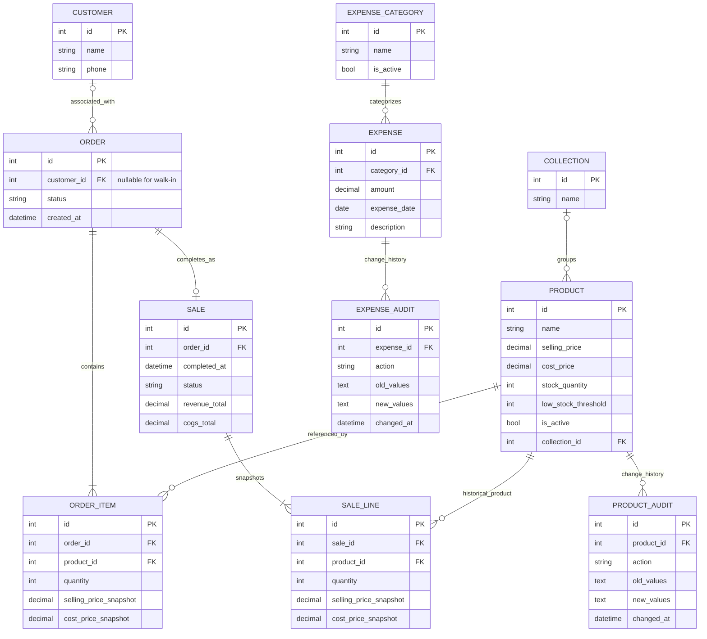

# Storefront — Proposed ERD (Draft)
**Version:** 0.1 | **Status:** Conceptual proposal; validate against existing models and migrations before implementation.

## Important design notes
- This ERD is a proposal, not a confirmed schema. The current project already has `Customer`, `Product`, `Collection`, `Order`, `OrderItem`, `Cart`, `CartItem`, and `Tag`; inspect their actual fields and migrations before deciding what to keep or change.
- A separate `SALE`/`SALE_LINE` may be unnecessary if `Order` and `OrderItem` can represent completed sales safely. Choose after repository audit to avoid duplicate sources of truth.
- Historical price and cost snapshots are required for reliable past COGS/profit reports.
- Product archive/deactivation should preserve references from historical order/sale lines.
- Pending orders do not reserve stock. Check current stock when completing a sale.
- Admin-only void/correction requires a reason and audit trail; stock restoration and report treatment remain open design decisions.
- Returns/refunds, discounts and tax calculation remain outside the initial scope.
- Monetary fields use a decimal type with two decimal places in PKR; calculation rounding policy remains open.
