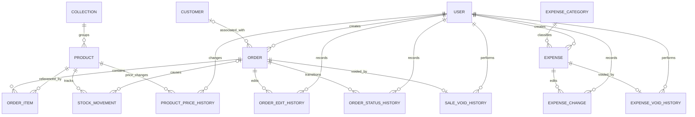

# Storefront ERD — Mermaid Source

## Core constraints
- Product.collection is nullable; deleting/removing a collection must not delete products.
- Product title is not unique; SKU is optional and unique if supplied.
- OrderItem has unique `(order_id, product_id)`.
- Customer is optional on Order.
- Stock changes and movement ledger writes are atomic.
- Price changes and price-history writes are atomic.
- Sale void and stock restoration are atomic and idempotent.
- Reports use inclusive Asia/Karachi date ranges.
