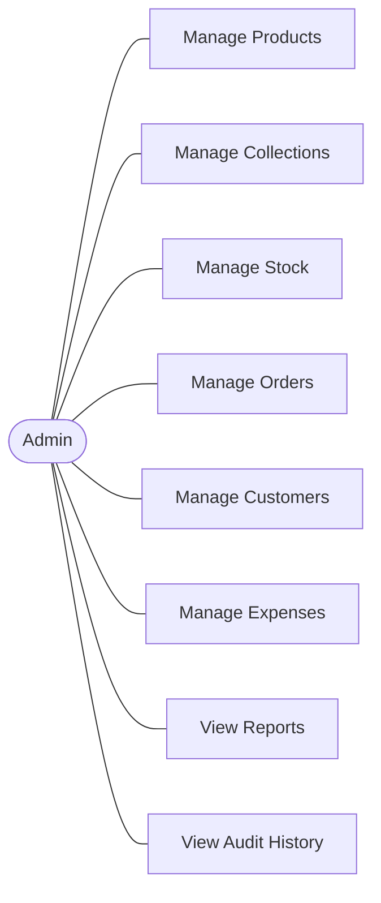
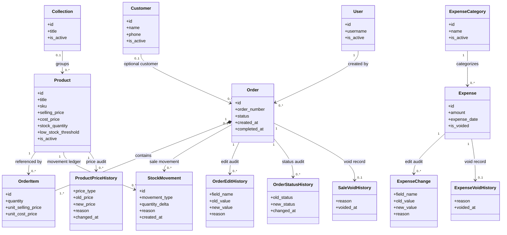
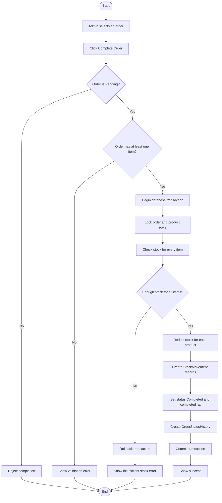
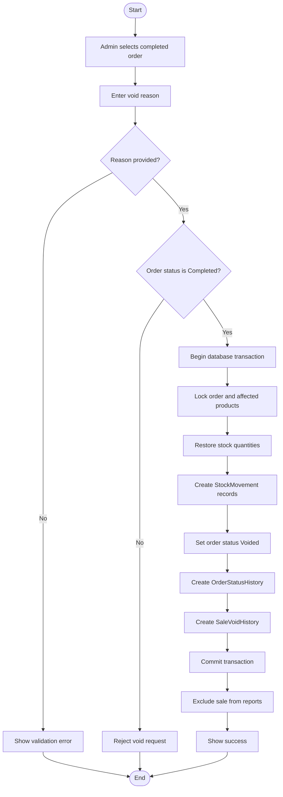
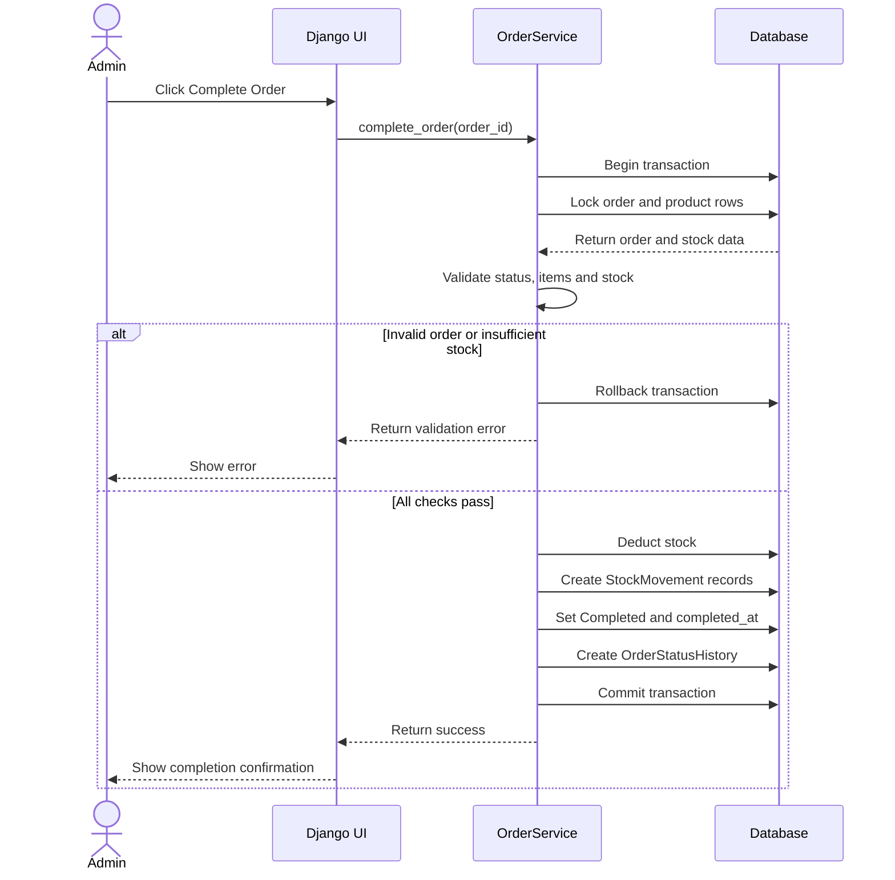
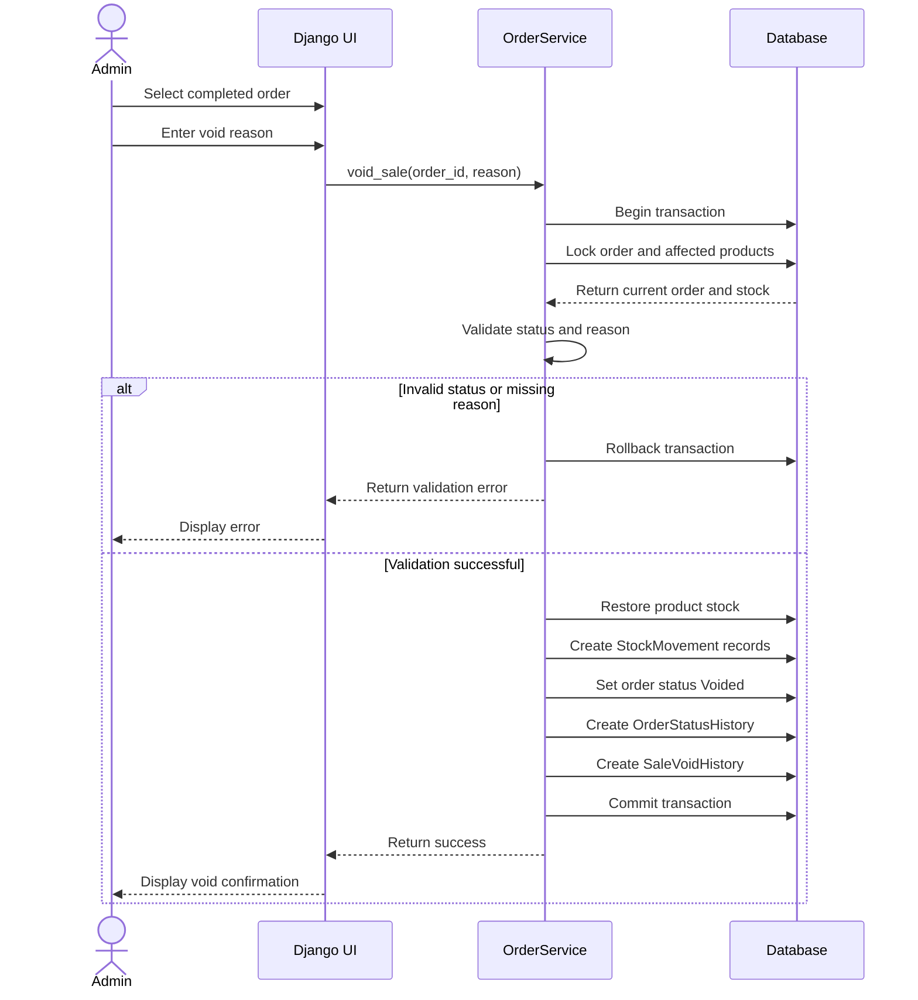

# Storefront — UML Diagrams

These are design drafts aligned to the agreed Storefront requirements. They describe intended behavior, not implemented code.

## Shared rules
- One Admin role in the initial version.
- Pending orders do not reserve stock.
- Order completion validates all items before stock deduction.
- Sale void requires a reason, restores stock, and preserves audit history.
- Use atomic database transactions for completion and void operations.
- Voided sales are excluded from revenue and COGS reports.
- `OrderService` is a proposed application service, not a Django built-in.

## 1. Use Case Diagram

Admin manages products, collections, stock, orders, customers and expenses, and can view reports and audit history.

## 2. Class Diagram

The class diagram is a conceptual model. Django field definitions, delete policies and service classes will be finalized during implementation.

## 3. Activity Diagram — Order Completion

The system validates every line before committing any deduction. If stock is insufficient, no partial update should remain.

## 4. Activity Diagram — Sale Void

Voiding preserves the original order and its history. The reason is mandatory, and restoration plus status changes are atomic.

## 5. Sequence Diagram — Order Completion

OrderService is a proposed project service layer, not a built-in Django class.

## 6. Sequence Diagram — Sale Void

The sale is excluded from revenue and COGS reports after voiding.

